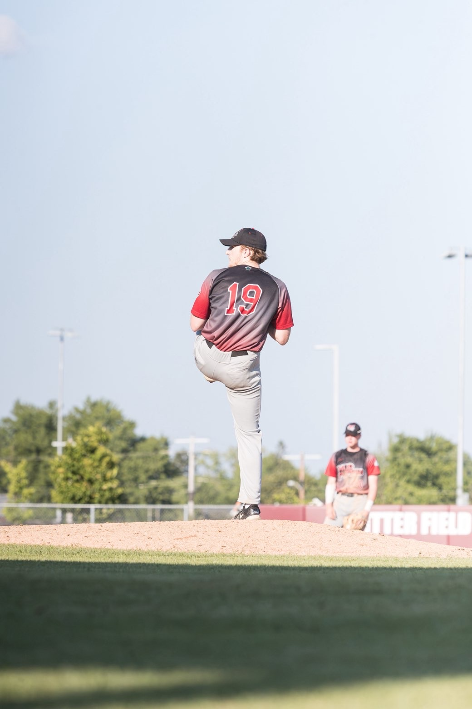

# Introduction

One of the biggest recent trends in baseball analytics is using pitching models to analyze a pitcher's effectiveness and performance. This summer, as an analytics intern for the Minnesota Mud Puppies, I had access to Northwoods League Trackman data for all teams across the league. With this data, I decided to make my own Stuff+ Model, centered on the Mud Puppies pitching staff. Stuff+ is an advanced sabermetric created by Max Bay and Eno Sarris that sets out to quantify the physical characteristics and "nastiness" of a pitch based on the pitch's traits. In Stuff+ models, a value of 100 represents a league average pitch, with anything higher being an "above-average" pitch. I wanted to build my own Stuff+ model to see how the pitchers on the Mud Puppies staff compare to both Northwoods League pitchers this season and MLB pitchers since the start of the 2024 MLB season. My work was inspired by [Adam Solario's Stuff+ model](https://medium.com/@adamsalorio/introducing-my-stuff-model-2840f196cf01), posted in May 2024 and found on Medium. Below are the packages I used to load and clean my data and create my model.

## Load Packages

Below are the packages I used during this project. I used `tidyverse` to clean my data, `BaseballR` to access MLB Statcast data, and `XGBoost` for my modeling.

```{r, message=FALSE}
library(tidyverse)
library(baseballr)
library(xgboost)
```

# Modeling the MLB

## Load Statcast Data

To start, I had to download MLB Statcast data to train my initial Stuff+ Model. I chose to use data starting in the 2024 season because it was the second season after the implementation of the pitch clock. By the 2024 season, pitchers had a season to adapt to the changes in work rate and game flow that came with the new pitch clock. Additionally, collecting data starting in 2024 gives me 2 and a half full seasons of Statcast data to work with. The `BaseballR` package has some difficulties with downloading large amounts of data at one time, so I used Claude to assist in writing this chunk of code to download the Statcast data from the 2024 season and onwards.

```{r, eval = FALSE}
# Set the windows for season Statcast data
season_windows<- tibble(
  season = c(2024, 2025, 2026),
  start  = as.Date(c("2024-03-20", "2025-03-18", "2026-03-26")),
  end    = as.Date(c("2024-09-29", "2025-09-28", "2026-08-30")
))

# Pull Statcast data from baseballr package over the 3 seasons
pull_statcast_data <- function(start_date, end_date, chunk_days = 5, save_path = NULL) {
  
  start_date <- as.Date(start_date)
  end_date <- as.Date(end_date)
  date_seq <- seq(start_date, end_date, by = chunk_days)
  
  map_dfr(date_seq, function(chunk_start) {
    chunk_end <- min(chunk_start + chunk_days - 1, end_date)
    message("Pulling ", chunk_start, " to ", chunk_end)
    
    result <- tryCatch({
      statcast_search(
        start_date = as.character(chunk_start),
        end_date = as.character(chunk_end),
        player_type = "pitcher")}, 
      error = function(e) {
      message("  -> FAILED: ", e$message)
      return(NULL)})
    
    if (!is.null(save_path) && !is.null(result) && nrow(result) > 0) {
      write_csv(result, save_path, append = file.exists(save_path))}
    
    result})
}

all_statcast <- pmap_dfr(
  list(season_windows$start, season_windows$end, season_windows$season),
  function(s, e, yr) {
    message("=== Season ", yr, ": ", s, " to ", e, " ===")
    pull_statcast_data(s, e, chunk_days = 4,
                         save_path = "statcast_2024_to_present.csv")
  }
)
```

## Clean Statcast data

To clean the Statcast data and make it match the TrackMan data I will later use for my Mud Puppies model, I made a few changes to variables and added a few new variables to the dataset. First, the Statcast pitch data tracks induced vertical break (IVB) and horizontal break (HB) in feet. To match the Northwoods League TrackMan data, I converted those IVB and HB values from feet to inches. One of the major features of the Stuff+ model is that it is trained on the expected run value of each pitch. To calculate these run values, you need the count and position of runners on base. Using Statcast's `delta_run_exp` (change in run expectancy) variable, I was able to create the average run value of each pitch based on count, runner position, pitcher handedness and batter handedness. Then, I consolidated the `events` and `descriptions` columns in to a single `results` column that matched the TrackMan results. Finally, I created 3 more variables to track the difference between the velocity, IVB, and HB of each pitch and the pitcher's primary fastball, and I gave each different pitch type thrown a numeric value. With all of these changes, I rejoined the run values to each pitch in the dataset, and now the data is ready for modeling.

```{r}
all_statcast <- readRDS("/Users/holden.peacock/Desktop/Internships/Mud Puppies/Stuff+/all_statcast.rds")

# Mutate to add a single runner position variable, a single count variable, and IVB and HB variables in inches
all_statcast <- all_statcast %>%
  filter(!is.na(pitch_type)) %>%
  mutate(runners = paste0(
    ifelse(!is.na(on_1b), "1", "-"),
    ifelse(!is.na(on_2b), "2", "-"),
    ifelse(!is.na(on_3b), "3", "-"))) %>%
  mutate(count = paste0(balls, "-", strikes)) %>%
  mutate(ivb = pfx_z * 12, 
         hb = pfx_x * 12) %>%
# Mutate to combine events and description column into single result variable
  mutate(result = case_when(
    # PA ending events take priority
    events == "home_run" ~ "Home Run",
    events == "single" ~ "Single",
    events == "double" ~ "Double",
    events == "triple" ~ "Triple",
    events == "strikeout" ~ "Strike Swinging",
    events == "walk" ~ "Walk",
    events == "hit_by_pitch" ~ "Hit By Pitch",
    events %in% c("field_out", "grounded_into_double_play",
                  "force_out", "sac_fly", "sac_bunt",
                  "double_play", "fielders_choice")  ~ "Out",
    # Non-PA-ending pitches fall through to description
    description == "swinging_strike" |
    description == "swinging_strike_blocked" ~ "Strike Swinging",
    description == "called_strike" ~ "Strike Called",
    description == "ball" |
    description == "blocked_ball" ~ "Ball Called",
    description == "foul" ~ "Foul Ball",
    description == "hit_into_play" ~ "In Play",
    TRUE ~ NA_character_))%>%
# Mutate to calculate velocity, IVB and HB differences from pitcher primary FB
  group_by(player_name) %>%
  mutate(primary_fb = {
    fastballs <- pitch_type[pitch_name %in% c("Four Seam", "Sinker", "Cutter", "Two Seam")]
    if (length(fastballs) == 0) NA_character_
    else names(which.max(table(fastballs)))}) %>%
  group_by(player_name, pitch_name) %>%
  mutate(avg_mph = mean(release_speed, na.rm = TRUE),
         avg_ivb = mean(ivb, na.rm = TRUE),
         avg_hb = mean(hb, na.rm = TRUE)) %>%
  group_by(player_name) %>%
  mutate(fb_mph = mean(release_speed[pitch_type == primary_fb], na.rm = TRUE),
         fb_ivb = mean(ivb[pitch_type == primary_fb], na.rm = TRUE),
         fb_hb = mean(hb[pitch_type == primary_fb], na.rm = TRUE),
         velo_diff = avg_mph - fb_mph, 
         ivb_diff = avg_ivb - fb_ivb,
         hb_diff = avg_hb - fb_hb) %>%
  ungroup()

# Create average run values based on count, result, pitcher hand, and batter hand
run_values <- all_statcast %>%
  group_by(count, result, p_throws, stand) %>%
  summarize(avg_rv = mean(delta_run_exp, na.rm = TRUE), .groups = "drop")

# Rejoin the run values to the Statcast data table and add a numeric column for pitch type to use in model
all_statcast <- all_statcast %>%
  left_join(run_values, by = c("count", "result", "p_throws", "stand")) %>%
  mutate(pitch_type_num = as.integer(as.factor(pitch_name)))
```

## Create XGBoost MLB Stuff+ Model

To start with creating my model, I set the features that I would be using to model each pitcher's stuff. This was largely dependent on what data was available through TrackMan. My model includes velocity, IVB, HB, spin rate, extension, release point, and pitch type. It also includes the difference between each pitch's velocity, IVB, and HB and those metrics for the pitcher's primary fastball. Ideally, I would have liked to include spin axis and vertical attack angle as well, but TrackMan did not have this data available for all players, so I chose to exclude them. After filtering out any N/A columns from our data, I created a training set using a random 80% of the pitches in the dataset and then a validation set from the remaining 20%. I also did a second cross-validation that grouped all pitches from the same pitcher together in the same fold. At the pitch level, the model beats a mean only baseline by a small margin, but this is to be expected as run value is far more dependent on the pitch outcome than stuff. My parameters set the tree depth, the learning rate, subsamples of the rows of data and features, and the number of rounds.

```{r}
# Set the target features for our model
features <- c("release_speed", "ivb", "hb", "release_spin_rate",
              "release_extension", "release_pos_x", "release_pos_z", "velo_diff", "ivb_diff", 
              "hb_diff", "pitch_type_num")

# Filter our NAs and infinte values and unnecessary columns
all_statcast <- all_statcast %>%
  filter(!is.na(avg_rv) & is.finite(avg_rv)) %>%
  filter(complete.cases(.[, features])) %>%
  select(game_date, player_name, pitch_name, p_throws, stand, runners, count, result,
         all_of(features), delta_run_exp, avg_rv)

# Create a training and validation set
set.seed(0428)
train_group <- sample(nrow(all_statcast), 0.8 * nrow(all_statcast))

# Set training target and predictor variables
x_train <- as.matrix(all_statcast[train_group, features])
x_validate <- as.matrix(all_statcast[-train_group, features])
y_train <- all_statcast$avg_rv[train_group]
y_validate <- all_statcast$avg_rv[-train_group]

# Convert to DMatrix
dtrain <- xgb.DMatrix(data = x_train, label = y_train)
dvalidate <- xgb.DMatrix(data = x_validate, label = y_validate)

# Set parameters
params <- list(objective = "reg:squarederror",
               max_depth = 4,
               eta = 0.05,
               subsample = 0.8,
               colsample_bytree = 0.8)

# Run the model
model_train <- xgb.train(params = params,
                         data = dtrain,
                         nrounds = 500,
                         evals = list(train = dtrain, val = dvalidate),
                         early_stopping_rounds = 20,
                         verbose = 0)
```

Below you can see the features that my Stuff+ model found to be most important. After running the XGBoost model, the most important features were IVB, velocity, and release height. The least important features were pitch type, extension, and each of the "difference" variables.

```{r}
# Feature importance
importance <- xgb.importance(model = model_train)
print(importance)
xgb.plot.importance(importance, top_n = 12, col = "steelblue", 
                    main = "Stuff+ Feature Importance")

# Generate predictions
all_statcast$predicted_rv <- predict(model_train, 
                                      xgb.DMatrix(as.matrix(all_statcast[, features])))

# Stuff+ ratings
all_statcast <- all_statcast %>%
  mutate(
    avg_stuff = mean(predicted_rv, na.rm = TRUE),
    sd_stuff = sd(predicted_rv, na.rm = TRUE),
    stuff_plus = 100 + ((-predicted_rv - avg_stuff) / sd_stuff) * 10
  )
```

Looking at the outputs from the model, Jacob Misiorowski's 4-seam is rated as the highest pitch by Stuff+, followed by Mason Miller's 4-seam, Chapman's sinker, and Miller's slider. The players with the best average Stuff+ from the last 3 seasons are Mason Miller, Jacob Misiorowski, and Josh Hader. While this does not perfectly reflect the ratings that FanGraphs has, some of the values are quite close. Any discrepancies likely come from differences in the factors in my model versus FanGraphs', or that my model tends to value IVB and velocity incredibly high. This would lead to pitchers who throw high-velocity fastballs, like Misiorowski and Miller, as well as pitchers like Alex Vesia, with high IVBs being rated very highly by my model.

```{r}
# Ranking the best individual pitches
pitch_ratings <- all_statcast %>%
  group_by(player_name, pitch_name) %>%
  summarise(pitches = n(),
            stuff_plus = mean(stuff_plus, na.rm = TRUE),
            .groups = "drop"
  ) %>%
  filter(pitches >= 100) %>%
  arrange(desc(stuff_plus))

head(pitch_ratings, 10)

# Ranking the players with the best overall stuff
stuff_ratings <- all_statcast %>%
  group_by(player_name) %>%
  summarize(
    pitches = n(),
    stuff_plus = mean(stuff_plus, na.rm = TRUE)
  ) %>%
  filter(pitches >= 100) %>%
  arrange(desc(stuff_plus))

head(stuff_ratings, 10)
```

# Modeling the Mud Puppies

## Cleaning Mud Puppies Data

To start modeling the Mud Puppies pitchers, I had to first clean the Mud Puppies data to match the MLB Statcast data. I ran the `load_trackman_data` and `combine_csv` functions to consolidate all of the TrackMan data into one single file. I then made the same changes as before to the Mud Puppies data, making a `results` variable and creating the velocity, IVB, and HB difference variables. Finally, I set each pitch type thrown by the Mud Puppies to match the numeric values of each pitch type from the Statcast data.

```{r, output=FALSE}
# Set base directory for function
base_dir <- "/Users/holden.peacock/Desktop/Internships/Mud Puppies/Stuff+/Game Files"

mudpuppies <- read.csv("stuffplus.csv")

# Set columns to be renamed to Statcast column names
column_rename <- c("player_name" = "Pitcher", "batter_team" = "BatterTeam", 
                   "pitcher_team" = "PitcherTeam", "p_throws" = "PitcherThrows", 
                   "game_date" = "Date", "release_speed" = "RelSpeed", 
                   "release_spin_rate" = "SpinRate", "stand" = "BatterSide", 
                   "pitch_name" = "AutoPitchType", "balls" = "Balls", "strikes" = "Strikes",
                   "description" = "PitchCall", "kbb" = "KorBB", "event" = "PlayResult", 
                   "ivb" = "InducedVertBreak", "hb" = "HorzBreak", "spin_axis" = "SpinAxis",
                   "release_extension" = "Extension", "release_pos_x" = "RelSide", 
                   "release_pos_z" = "RelHeight")

# Statcast columns names
columns <- c("player_name", "batter_team", "pitcher_team", "p_throws", "game_date", 
             "release_speed", "release_spin_rate", "stand", "pitch_name", "balls", "strikes", 
             "description", "kbb", "event", "ivb", "hb", "spin_axis", "release_extension", 
             "release_pos_x", "release_pos_z")

# Function that loads csv files and renames columns to Statcast column names
load_trackman_data <- function(csv) {
  d <- read_csv(csv, show_col_types = FALSE, na = c("", "NA", "-"))
  pitcher_data <- d %>%
    rename(all_of(column_rename))%>%
    filter(pitch_name != "Undefined")
  return(d)
}

# Function that combines all game CSV files into one single CSV
combine_csv <- function(game_files){
  game_csv <- list.files(game_files, pattern = "\\.csv$", full.names = TRUE)
  
  for (file in game_csv) {
      d <- load_trackman_data(file)
      mudpuppies <- rbind(mudpuppies, d)
  }
  return(mudpuppies)
}

mudpuppies <- combine_csv(base_dir)

# Cleaning Mud Puppies data
mudpuppies <- mudpuppies %>%
  rename(all_of(column_rename)) %>%
  select(columns)

mudpuppies <- mudpuppies %>%
  filter(pitcher_team == "MIN_M") %>%
  mutate(count = paste0(balls, "-", strikes)) %>%
  mutate(result = case_when(
    event == "HomeRun" ~ "Home Run",
    event == "Single" ~ "Single",
    event == "Souble" ~ "Double",
    event == "Triple" ~ "Triple",
    event == "Out" ~ "Out",
    kbb == "Strikeout" ~ "Strike Swinging",
    kbb == "Walk" ~ "Walk",
    description == "StrikeSwinging" ~ "Strike Swinging",
    description == "StrikeCalled" ~ "Strike Called",
    description == "BallCalled" ~ "Ball Called",
    description == "FoulBallNotFieldable" |
    description == "FoulBallFieldable" ~ "Foul Ball",
    description == "HitByPitch" ~ "Hit By Pitch",
    TRUE ~ NA_character_))%>%
  select(-batter_team, -event, -description, -kbb, -balls, -strikes)

mudpuppies <- mudpuppies %>%
  relocate(game_date, .before = player_name) %>%
  relocate(stand, .after = p_throws) %>%
  relocate(pitch_name, .before = release_speed) %>%
  relocate(count, result, .after = release_speed) %>%
  group_by(player_name) %>%
  mutate(primary_fb = {
    fastballs <- pitch_name[pitch_name %in% c("Four Seam", "Sinker", "Cutter", "Two Seam", "Four-Seam")]
    if (length(fastballs) == 0) NA_character_
    else names(which.max(table(fastballs)))}) %>%
  group_by(player_name, pitch_name) %>%
  mutate(avg_mph = mean(release_speed, na.rm = TRUE),
         avg_ivb = mean(ivb, na.rm = TRUE),
         avg_hb = mean(hb, na.rm = TRUE)) %>%
  group_by(player_name) %>%
  mutate(fb_mph = mean(release_speed[pitch_name == primary_fb], na.rm = TRUE),
         fb_ivb = mean(ivb[pitch_name == primary_fb], na.rm = TRUE),
         fb_hb = mean(hb[pitch_name == primary_fb], na.rm = TRUE),
         velo_diff = avg_mph - fb_mph, 
         ivb_diff = avg_ivb - fb_ivb,
         hb_diff = avg_hb - fb_hb) %>%
  ungroup() %>%
  mutate(pitch_name = case_when(
    pitch_name == "Four-Seam" ~ "4-Seam Fastball",
    pitch_name == "Splitter" ~ "Split-Finger",
    TRUE ~ pitch_name))

statcast_levels <- levels(as.factor(all_statcast$pitch_name))

mudpuppies <- mudpuppies %>%
  mutate(pitch_type_num = as.integer(factor(pitch_name, levels = statcast_levels)))  
```

## Modeling the Mud Puppies vs. the MLB

For the Mud Puppies Stuff+ model, I used the past MLB model to predict the Stuff+ ratings of the Mud Puppies pitches. Like for the MLB, I created rankings of the best individual pitches and best overall arsenals for the Mud Puppies pitching staff. The best individual pitches were Aiden Smith's (North Dakota St.) sinker, Logan Grinnell's (Gustavus Adolphus) 4-seam, and Andrew Brandt's (Kirkwood CC) curveball. There were only 13 individual pitches on the Mud Puppies that had a Stuff+ rating of above 100, or above MLB-average. Overall, the pitchers with the highest average Stuff+ ratings were Patrick Binnebose (Iowa Central CC), Carson Schroeder (Iowa Central CC), and Logan Campbell (South Dakota St.). No pitcher on the Mud Puppies staff had a overall Stuff+ rating above 100 on the MLB scale.

```{r}
x_mudpuppies <- as.matrix(mudpuppies[, features])

mudpuppies$predicted_rv <- predict(model_train,
                                     xgb.DMatrix(x_mudpuppies))

avg_stuff <- all_statcast$avg_stuff[1]
sd_stuff <- all_statcast$sd_stuff[1]

mudpuppies$stuff_plus <- 100 + ((-mudpuppies$predicted_rv - avg_stuff) / sd_stuff) * 10
  
# Ranking the best Mud Puppies pitches
pups_pitches <- mudpuppies %>%
  filter(!is.na(pitch_name)) %>%
  group_by(player_name, pitch_name) %>%
  summarise(
    pitches    = n(),
    stuff_plus = mean(stuff_plus, na.rm = TRUE),
    .groups    = "drop"
  ) %>%
  arrange(desc(stuff_plus))

head(pups_pitches, 10)

# Ranking the best Mud Puppies pitchers by stuff
pups_stuff <- mudpuppies %>%
  filter(!is.na(pitch_name)) %>%
  group_by(player_name) %>%
  summarise(
    pitches    = n(),
    stuff_plus = mean(stuff_plus, na.rm = TRUE),
  ) %>%
  arrange(desc(stuff_plus))

head(pups_stuff, 10)
```

# Modeling the Mud Puppies vs. the Northwoods League

After looking at how the Mud Puppies compared to MLB pitching, I thought it would make the most sense to apply the model to the rest of the Northwoods League to see how the Mud Puppies compared to their opponents. While it is interesting to see how they would compare to MLB pitching, it is not a surprising result that every pitcher on the staff has below-average MLB stuff. Using the data from pitchers I also did scouting reports on, I applied the model to the entire Northwoods League and created a separate NWL Stuff+ rating.

## Cleaning Opponent Data

To clean the data, I made the same changes as before to the two other data sets. My `combine_opponents` function allowed me to combine all of the different CSV files I had for scouting into one master file. I then made all the same changes to the data as with the Mud Puppies and MLB data.

```{r}
secondary_dir <- "/Users/holden.peacock/Desktop/Internships/Mud Puppies/Scouting"
source("/Users/holden.peacock/Desktop/Internships/Mud Puppies/Scouting/scouting_functions.R")

# Function that combines all game CSV files into one single CSV
combine_opponents <- function(scouting_folder) {
  team_folders <- list.files(scouting_folder, full.names = TRUE)
  all_data <- list()
  
  for (folder in team_folders) {
    csv_files <- list.files(folder, pattern = "\\.csv$", full.names = TRUE)
    for (file in csv_files) {
      d <- load_scouting_data(file)
      all_data <- append(all_data, list(d))
    }
  }
  return(bind_rows(all_data))
}

opponents <- combine_opponents(secondary_dir)

# Rename columns in opponents dataset
opponents <- opponents %>%
  rename("player_name" = "pitcher_name", "pitcher_team" = "team", "p_throws" = "pitcher_hand", 
         "game_date" = "date", "release_speed" = "mph", "release_spin_rate" = "rpm", 
         "stand" = "batter_hand", "pitch_name" = "pitch_type", 
         "release_extension" = "extension", "release_pos_x" = "rel_side_ft", 
         "release_pos_z" = "rel_height_ft")

# Clean opponents data to match Mud Puppies and MLB data
opponents <- opponents %>%
  mutate(game_date = as.Date(paste0(game_date, "/2026"), format = "%m/%d/%Y")) %>%
  relocate(game_date, .before = player_name) %>%
  relocate(stand, .after = p_throws) %>%
  relocate(pitch_name, .before = release_speed) %>%
  relocate(count, result, .after = release_speed) %>%
  group_by(player_name) %>%
  mutate(primary_fb = {
    fastballs <- pitch_name[pitch_name %in% c("Four Seam", "Sinker", "Cutter", "Two Seam", "Four-Seam")]
    if (length(fastballs) == 0) NA_character_
    else names(which.max(table(fastballs)))}) %>%
  group_by(player_name, pitch_name) %>%
  mutate(avg_mph = mean(release_speed, na.rm = TRUE),
         avg_ivb = mean(ivb, na.rm = TRUE),
         avg_hb = mean(hb, na.rm = TRUE)) %>%
  group_by(player_name) %>%
  mutate(fb_mph = mean(release_speed[pitch_name == primary_fb], na.rm = TRUE),
         fb_ivb = mean(ivb[pitch_name == primary_fb], na.rm = TRUE),
         fb_hb = mean(hb[pitch_name == primary_fb], na.rm = TRUE),
         velo_diff = avg_mph - fb_mph, 
         ivb_diff = avg_ivb - fb_ivb,
         hb_diff = avg_hb - fb_hb) %>%
  ungroup() %>%
  mutate(pitch_name = case_when(
    pitch_name == "Four-Seam" ~ "4-Seam Fastball",
    pitch_name == "Four Seam" ~ "4-Seam Fastball",
    pitch_name == "Splitter"  ~ "Split-Finger",
    TRUE ~ pitch_name)) %>%
  mutate(pitch_type_num = as.integer(factor(pitch_name, levels = statcast_levels)))
```

## Modeling the Mud Puppies vs. the NWL

Same as before, I applied the model to the new Northwoods League data, but this time, I also found the average and standard deviation of Stuff+ for the Northwoods League in order to calculate the NWL Stuff+. I then updated my two rankings of the Mud Puppies pitchers. With the Northwoods League Stuff+, the same three individual pitches remained at the top, as well as the same three pitchers overall. However the ratings change quite a bit compared to the MLB model. Now 106 individual Mud Puppies pitches are Northwoods League-average or better. Similarly, 22 of 28 pitchers on the Mud Puppies staff were league-average or above.

```{r}
# Set features available in opponents' data
x_opponents <- as.matrix(opponents[, features])

opponents$predicted_rv <- predict(model_train, xgb.DMatrix(x_opponents))

# Combine opponent and Mud Puppies data to find NWL averages
nwl <- bind_rows(opponents %>% mutate(source = "opponents"),
                 mudpuppies %>% mutate(source = "mudpuppies"))

# Calculate the mean and SD predicted run values from NWL pitching data
avg_stuff_nwl <- mean(-nwl$predicted_rv, na.rm = TRUE)
sd_stuff_nwl <- sd(-nwl$predicted_rv, na.rm = TRUE)

# Apply those values to find Mud Puppies and opponent Stuff+ Ratings compared to NWL pitchers
mudpuppies <- mudpuppies %>%
  mutate(stuff_plus_nwl = 100 + ((-predicted_rv - avg_stuff_nwl) / sd_stuff_nwl) * 10)

opponents <- opponents %>%
  mutate(stuff_plus_nwl = 100 + ((-predicted_rv - avg_stuff_nwl) / sd_stuff_nwl) * 10)

# MLB and NWL Stuff+ for individual pitches 
pups_pitches <- mudpuppies %>%
  filter(!is.na(pitch_name)) %>%
  group_by(player_name, pitch_name) %>%
  summarise(
    pitches    = n(),
    stuff_plus = mean(stuff_plus, na.rm = TRUE),
    stuff_plus_nwl = mean(stuff_plus_nwl, na.rm = TRUE),
    .groups    = "drop"
  ) %>%
  arrange(desc(stuff_plus_nwl))

head(pups_pitches, 10)

# Overall Stuff+ for each pitcher
pups_stuff <- mudpuppies %>%
  filter(!is.na(pitch_name)) %>%
  
  group_by(player_name) %>%
  summarise(
    pitches    = n(),
    stuff_plus = mean(stuff_plus, na.rm = TRUE),
    stuff_plus_nwl = mean(stuff_plus_nwl, na.rm = TRUE),
  ) %>%
  arrange(desc(stuff_plus_nwl))

head(pups_stuff, 10)
```

Overall, this was a fun exercise to do and one of my first in-depth attempts at making a baseball model. Based on the crossover between my Stuff+ model and FanGraphs', I am fairly confident in results from my model. However, I do feel like there is some room for growth regarding my Northwoods League data and model. Some pitchers on our staff only threw 10 pitches in front of a TrackMan this summer. The sample size for just the Mud Puppies staff is only 2500 pitches, which is tiny compared to the 1.8 million pitches in the Statcast MLB data that trained my original model. The small sample size may lead some pitchers to being over or underrated by my Stuff+ model. Similarly, there were some pitch factors that I would have liked to add to my model if the data were available. I think VAA and spin axis could add value to the model if I were able to add them and apply them to the Northwoods League data. Ultimately, this is just one of the first renditions of the model, and I hope to continue to grow it as I gain more experience in modeling baseball. I would love any feedback and thoughts on the model, so please reach out with any suggestions! [Here](https://drive.google.com/uc?export=download&id=1BDeOZOgyNDgH48SJDINOeBKZveZewHhz) is a link to the files that I used on this project in the background.

Thank you for reading!
